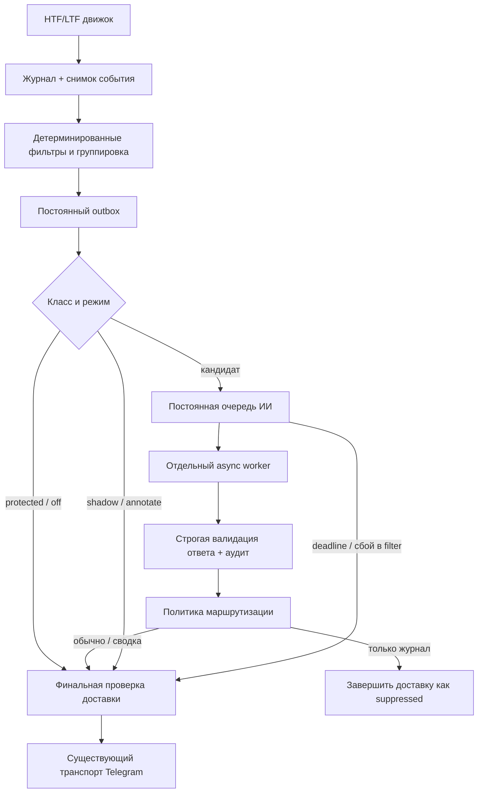

# Техническое задание: ИИ-фильтр событий HTF/LTF и уведомлений Telegram

Версия: 1.1. Дата: 10.10.2026. Проект: LevelFrame / htfdec.

Статус: внедрение ИИ отменено владельцем на текущем этапе (10.10.2026). Документ сохранён как архив проекта, не является текущим планом реализации. Код ИИ-фильтра этим документом не внедрён. Численные пороги ниже — прежние предлагаемые настройки, не результаты эксперимента.

Зависимость: [согласованные правила контекста HTF/LTF](HTF_LTF_Context_Rules_v1_2026-10-10.md). Они имеют приоритет в вопросах направления, смены/возврата контекста, PD и текущего теста зоны. Перед рабочей фильтрацией реализовать эти правила и устранить ошибки причинности из [аудита](HTF_LTF_Engine_Audit_Questions_RU_2026-10-10.md). ИИ не компенсирует противоречия движка. Неопределённые детали перечислены в §12 правил; они не считаются согласованными параметрами.

## 1. Назначение и ожидаемый результат

Добавить перед доставкой уведомлений HTF/LTF независимую оценку значимости события с помощью языковой модели. Фильтр должен уменьшать количество малополезных уведомлений, сохранять важные изменения рыночного состояния и давать короткое, проверяемое объяснение решения.

ИИ получает факты, уже рассчитанные движком, и оценивает их связь с контекстом. Итоговый маршрут уведомления выбирает код по версионированной политике. Исходные события продолжают храниться в журнале независимо от решения фильтра.

Пользователь должен иметь возможность узнать: какое событие возникло, какие сведения видел ИИ, что он предложил, какое решение приняла система и было ли сообщение действительно отправлено в Telegram.

Цели первой версии:

1. Оценивать HTF-приближения, касания и промежуточные обновления, а также LTF-готовность зон и касания.
2. Выбирать один маршрут: обычная доставка, тихая сводка, только журнал.
3. Защищать структурные переходы, отмены, завершение зон и служебные инциденты от ИИ-подавления.
4. Ограничивать задержку, стоимость и объём отправляемых модели данных.
5. Включать фильтрацию только после сравнения с текущим поведением на отложенных данных и в режиме наблюдения.

Уменьшение числа сообщений само по себе не считается успехом. Основная мера качества — сколько полезных уведомлений сохранено при сокращении шума. Доходность, если впоследствии измеряется, требует отдельного определения торговой стратегии, комиссий и исполнения.

## 2. Область действия

В первую версию входят каналы `htf` и `ltf`, общая очередь Telegram, хранение решений, диагностика в приложении и настройки владельца. Оценка работает с текстовым JSON; отправка графиков модели, интернет-поиск и инструменты выполнения кода для модели не нужны.

За рамками версии 1: фильтрация ALT, модуль `app/events`, поиск новых зон моделью, изменение правил BOS/SMS, расчёт торговых ордеров, автоторговля, персональное управление капиталом, обучение собственной модели, автоматическое изменение порогов по результатам сделок.

Общий outbox обслуживает и другие каналы. Поэтому все изменения должны иметь явный allowlist `htf,ltf`; обработка `alt`, `service`, `incident`, `chart` и собственно контейнера `digest` не вызывает модель.

## 3. Текущее устройство проекта и точки интеграции

| Узел | Текущее назначение | Требуемая интеграция |
|---|---|---|
| `app/models.py`, таблица `event` | HTF-события с `occurred_at`, `detected_at`, `evidence` | Ссылка на неизменяемый снимок фактов для оценки |
| `app/models_ltf.py`, таблица `ltf_event` | LTF-события, payload, processing mode, признаки доставки | Снимок фактов и отдельный аудит решения |
| `app/notify/queue.py` | HTF-фильтры, группировка, отпечатки фактов | Формирование кандидатов после существующих ограничений |
| `app/notify/ltf_queue.py` | LTF-допуски, группировка переходов, актуальность входа | Аналогичное подключение, сохранение `market_transition_key` |
| `app/notify/outbox.py` | Постоянная очередь, сводки, отправка, retry, `uncertain` | Неблокирующий gate перед отправкой и сборкой сводки |
| `app/services/quality.py` | Каноническая оценка качества данных | Источник quality-фактов; ИИ не отменяет её ограничения |
| `app/services/asset_state.py` | Каноническая проекция состояния актива | Источник структуры и контекста после аудита причинности |
| `app/services/htf_context.py`, `h1_setup.py` | Эпизоды HTF, ноги H1, PD, развороты и допуск зон | Нормализованные факты на заданную временную отсечку |
| `app/main.py` | Запуск worker, outbox, бота и API | Отдельная задача ИИ-обработчика и корректное завершение |
| `app/schema.sql`, `app/db.py` | SQLite и миграции | Новые таблицы, индексы, идемпотентная миграция |
| `app/bot/handlers.py`, `app/web/*` | Управление и просмотр | Настройки, причины фильтрации, статистика |

Особенности, которые обязательны к учёту:

- `Outbox.flush()` удерживает общий async-lock. HTTP-запрос к модели внутри этого lock запрещён.
- HTF и LTF могут вызвать `outbox.flush()` непосредственно при постановке событий. Фильтр должен работать и на этом пути, и в фоновом `outbox.run()`.
- `_digest()` сейчас подбирает дополнительные quiet-пакеты. Этот подбор также должен проверять ИИ-gate; иначе оценку можно обойти через сводку.
- `_send()` повторно проверяет digest, но для обычного пакета требуется единый финальный барьер проверки актуальности перед транспортом.
- Один LTF-пакет может объединять отмену старого сценария и подтверждение нового по `market_transition_key`.
- `ltf_event.delivered=True` используется также для завершённой обработки без отправки. Это не доказательство фактической доставки. Источником такой информации остаются outbox и аудит маршрута конкретного получателя.
- Рендереры сейчас по-разному учитывают `notification_member.reason`. При интеграции нужно явно разделить видимые события и события для подробностей, чтобы частичное подавление не терялось и не просачивалось в подпись.

## 4. Обязательные инварианты

| ID | Требование |
|---|---|
| INV-01 | ИИ не изменяет зоны, направление канонической структуры, жизненный цикл, сценарии и исходные payload/evidence |
| INV-02 | ИИ не создаёт рыночных событий и не назначает цены входа, цели, стопы или размер позиции |
| INV-03 | Исходное событие записано до постановки задания ИИ; отсутствие ИИ не мешает записи рынка |
| INV-04 | Mute, выключенный актив, watchlist, настройки групп, replay, дубли и недопуск входа имеют приоритет над ИИ |
| INV-05 | Защищённое событие не задерживается ожиданием ИИ и не подавляется ИИ |
| INV-06 | При ошибке ИИ используется обычный маршрут, если текущие детерминированные проверки его разрешают |
| INV-07 | Отсутствующие данные представлены явно; `null` не превращается в ноль, отрицание или подтверждённый факт |
| INV-08 | Снимок события причинный: в него не входят сведения, ещё неизвестные на его временную отсечку |
| INV-09 | Результат ИИ не может возобновить отправку `sent`, `uncertain` или окончательно подавленного пакета |
| INV-10 | Retry Telegram не вызывает повторную оценку того же снимка |
| INV-11 | Режим `off` сохраняет прежнюю бизнес-семантику уведомлений; добавочные таблицы не запускают рассылку истории |
| INV-12 | AI-score — оценка значимости уведомления, а не вероятность движения цены или прибыльной сделки |
| INV-13 | Секреты, Telegram chat ID, пользовательские токены и внутренняя конфигурация не передаются модели |

«Защищённое» означает защищённое именно от ИИ. Пользовательское отключение уведомлений, существующее подавление дублей и запрет исторической рассылки продолжают действовать.

В этой версии «прежний/обычный маршрут» и baseline означают поведение той же версии движка с ИИ в режиме off. Отключение ИИ не откатывает согласованные изменения HTF/LTF к старым правилам PD и глубины теста.

## 5. Режимы работы

| Режим | Вызов модели | Влияние на Telegram | Назначение |
|---|---|---|---|
| `off` | Нет | Текущее поведение | Исходное состояние и аварийное отключение |
| `shadow` | Да, для выбранных кандидатов | Нет, даже при позднем ответе | Сбор оценок и сравнение с обычной доставкой |
| `annotate` | Да | Маршрут обычный; готовое объяснение можно добавить | Проверка формулировок на практике |
| `filter` | Да | Маршрут по политике; ожидание ограничено deadline | Рабочая фильтрация после приёмки |

После установки миграции default — `off`. Первый запуск с настроенным API — `shadow`. Режимы задаются отдельно для HTF и LTF, а при необходимости ограничиваются списком инструментов. Для событий вне canary-списка действует `off`.

В `shadow` и `annotate` отправка не ждёт модель. Если объяснение не готово в момент рендера, сообщение идёт без него. Поздний ответ сохраняется в диагностике, но не редактирует уже отправленное сообщение ради ИИ-комментария.

При выключении фильтра ещё не отправленные AI-wait пакеты немедленно возвращаются к обычной проверке доставки. Уже подавленные ИИ события автоматически не рассылать. Ручной повтор допускается только отдельной явной операцией, за пределами MVP.

## 6. Матрица событий

### 6.1. HTF

| Виды `EventKind` | Класс | Действия ИИ в режиме filter |
|---|---|---|
| `approach`, `already_in_zone` | Информационные кандидаты | Оставить в сводке или только в журнале; не повышать до срочной карточки |
| `depth_50`, `depth_90`, `fvg_weakened` | Промежуточные изменения | Сводка или журнал; проверить protected override ниже |
| `touch` | Значимое взаимодействие | Обычная доставка, сводка или журнал по рубрике |
| `d1_close_inside` | Подтверждённый факт закрытия | Защищено |
| `ob_confirmed`, `breaker_created`, `zone_confirmed_by_user` | Создание/подтверждение контекста | Защищено |
| `fvg_filled`, `ob_invalidated`, `breaker_archived`, `prb_archived`, `level_taken`, `jump_through` | Завершение/изменение состояния | Защищено |
| `data_stale`, `data_recovered` | Качество источников | Обход ИИ |

Protected override: если промежуточное событие по правилам конкретного типа зоны фиксирует завершение, потерю допуска или отмену ранее сообщённого состояния, оно становится защищённым. В частности, нельзя считать всякий `depth_90` обычным шумом: семантика PRB и OB различается. Класс определяется кодом по версии движка, типу зоны и transition evidence, а не догадкой модели.

Дополнение политики v1.1: первая квалифицированная активация сценария от HTF, подтверждённая смена, провал и восстановление контекста защищены независимо от технического kind. Это относится и к текущему активирующему тесту OB90/FVG100, и к контакту BSL/SSL, запускающему ожидание LTF. Физическое заполнение FVG не означает автоматической отмены текущей активации. Информационные касания без этих ролей остаются кандидатами матрицы.

### 6.2. LTF

| Виды `LtfEvent.kind` | Класс | Действия ИИ в режиме filter |
|---|---|---|
| `range_ready` | Промежуточная готовность диапазона | Сводка или журнал |
| `entries_ready` | Доступны зоны наблюдения/входа по движку | Обычная доставка, сводка или журнал |
| `touch` | Касание допустимой зоны по котировке | Обычный маршрут без ожидания ИИ; оценка только параллельно |
| `bos`, `sms` | Структурный факт | Защищено |
| `cancellation` | Отмена сценария | Защищено |
| `sweep_confirmed`, `sweep_failed` | Результат теста ликвидности | Защищено |
| `note`, `context_update` | В текущем `_KIND_GROUP` не разрешены | Не включать рассылку этим ТЗ |

Любой пакет с защищённым участником либо структурным `market_transition_key` проходит обычным маршрутом целиком, без ожидания и без изменения состава ИИ. Это сохраняет одну карточку структурного перехода.

LTF touch фиксируется по котировке без ожидания закрытия H1. Для выполнения требования немедленного уведомления ИИ не меняет его маршрут и не задерживает отправку; настройки получателя и дедупликация сохраняются. Последующая обработка закрытой H1 не создаёт дубликат этого касания.

Неизвестный новый вид события не подавлять по умолчанию: вернуть управление существующей политике, записать `unclassified_kind` в диагностику. Если существующая политика его не отправляла, ИИ также не включает отправку.

## 7. Архитектура и порядок обработки



Последовательность для кандидата:

1. Записать событие и причинный снимок либо явный признак невозможности его получить.
2. Применить текущие правила уведомлений, дедупликацию, настройки получателя и актуальность. Отклонённые ими события не расходуют API-бюджет.
3. Сформировать пакет прежним semantic key. Разбивка из-за разных мнений модели не меняет ключи рыночных фактов.
4. Зафиксировать обычный маршрут до вмешательства ИИ: `baseline_route=immediate|digest`.
5. Для кандидатов сформировать/найти задание по ключу снимка и версии оценивания. В `filter` пакет ожидает результат до deadline; другие пакеты продолжают обрабатываться.
6. Worker атомарно захватывает задание, резервирует бюджет и вызывает модель вне SQLite-транзакции и outbox-lock.
7. Проверить структуру ответа, допустимые значения и ссылки на факты; вычислить score кодом.
8. Политика с учётом режима, класса события и текущего состояния выбирает маршрут.
9. Повторно проверить mute, качество, актуальность, superseded и lifecycle непосредственно перед захватом отправки и после длительного рендера графика.
10. Отправить существующим транспортом либо завершить обработку как `suppressed`, сохранив причину и ID решения.

Приоритет итогового решения: пользовательские запреты и валидность данных → дедупликация/актуальность → protected-класс → режим → валидная оценка ИИ → fallback.

Ожидание свежих рыночных данных (`wait` существующего LTF-валидатора) отдельно от ожидания ИИ. Истечение AI-deadline не снимает market-data wait и не разрешает неактуальный вход. После восстановления данных снова проверяются актуальность и причины подавления; AI-fallback использует только разрешённый обычный маршрут.

Изменить выборку готовых outbox-пакетов: первые 100 ожидающих ИИ строк не должны постоянно занимать `LIMIT 100` и закрывать доступ к готовому пакету за ними. Использовать выборку по send eligibility и отдельную обработку истёкших gate либо ограниченную пагинацию с доказанным отсутствием starvation. Будящий сигнал ИИ не обходит существующий Telegram backoff.

## 8. Контракт входных данных

### 8.1. Снимок и временная причинность

Ввести `EventAssessmentSnapshot`, JSON schema версии `htf-ltf-ai-input-v1`. Снимок неизменяемый, содержит `event_as_of=occurred_at`, время записи `captured_at` и время доступности каждого доказательства `available_at`.

Использовать только:

- свечи, закрытые не позже `event_as_of`;
- pivot, подтверждённые не позже отсечки, даже если экстремум возник раньше;
- зоны, сценарии и версии PD, уже существовавшие и известные на отсечку;
- quote для внутрисвечного касания с timestamp не позже события и с подтверждённым происхождением;
- исторические взаимодействия и структурные ключи, известные к этому моменту.

Чтение текущей изменяемой записи зоны через API с параметром `as_of` само по себе не доказывает причинность. До переиспользования `project_asset`, `project_setup`, `reversal_projection`, `data_quality` провести аудит всех внутренних запросов. Текущее состояние котировки и зоны нельзя выдавать за историческое. Недоступное историческое значение помечать `unknown`.

Для новых live-событий сохранять факты при их создании либо из того же согласованного состояния до дальнейших мутаций. Создание job выполняется позднее и не обязано быть в транзакции движка. Если запись снимка не удалась, событие сохраняется, ИИ для него получает `snapshot_unavailable`, доставка идёт по обычным правилам.

Отдельно перед отправкой строится `DeliveryGuardSnapshot` с текущим временем. Он проверяет актуальность, но не подменяет исторический снимок, уже оценённый моделью. Если контекст существенно сменился, оценка помечается неприменимой; новый рыночный переход должен обрабатываться собственным событием.

Существенные изменения для применимости оценки: другая каноническая нога/направление, отмена сценария, изменение геометрии или допуска оцениваемой entry zone, завершение опорного эпизода, новая ревизия обязательных фактов. Обычное обновление котировки без этих изменений не требует нового вызова модели. Перед сводкой через 15 минут действуют те же проверки; просроченное объяснение ИИ не выдаётся за оценку текущего рынка.

### 8.2. Состав снимка

| Блок | Поля и смысл |
|---|---|
| `schema_version`, `engine_versions` | Версии схемы и правил движка |
| `event` | Канал, kind, время события/обнаружения, processing mode, цена, цикл, роль события |
| `instrument` | Символ, площадка, тип рынка, точность цены |
| `htf_contexts` | Основной, встречный и предыдущий контексты; D1/W1 равноправны; источники OB/FVG/BSL/SSL, направление ожидания, границы, контакт, связи переходов и доказательство прохода закрытием собственного ТФ |
| `h1_structure` | BOS/SMS, ключ, pivot reference, цена и время подтверждения; роль correction/opposing_confirmation/context_return/continuation и связь с зоной интереса H1 |
| `setup` | Направление, состояние; PD preliminary/confirmed/absent, структурные опоры, pd_anchor_bos_key и причинный HTF-контакт; причины допуска и блокировки |
| `entry_zones` | Полная геометрия, тип, lifecycle, связь со сценарием; activation_id, visit_id, depth_before_visit, consumed_before_activation, current_activation_valid; положение в PD как описание |
| `market_progress` | Что нового добавило событие относительно предыдущей стадии того же объекта/эпизода |
| `quality_at_event` | Качество обязательных данных, пропуски, отставание; неизвестное состояние отдельно |
| `evidence` | Факты с короткими ID, типом, значением, единицей, источником, `available_at` |
| `assessment_constraints` | Допустимые категории, выявленные отсутствующие поля, ограничения рубрики |

Контекст получателя, его chat ID и история фактической рассылки в запрос модели не входят. Общую оценку рынка можно переиспользовать для разных получателей; их настройки и подавление повторов применяет локальная политика.

Правила нормализации:

- Цены — decimal-строки с точностью инструмента; отношения — числа с указанной единицей (`fraction` или `percent`).
- Все timestamps — миллисекунды UTC. МСК используется только при показе человеку.
- Direction — `bull|bear|neutral|unknown`; status — перечисление из схемы, не свободный текст.
- Контакт BSL запускает ожидание bear, SSL — bull; смена основного контекста требует LTF-подтверждения. Само пересечение не называется sweep без подтверждённого возврата; снятая ликвидность не объявляется снова нетронутой.
- Исторически заполненный до активации FVG не предлагается как новый свежий источник. Заполнение на 100% в текущем активирующем визите сохраняет основание текущей реакции LTF. Аналогично различать прежний и текущий тест OB на 90%; одного текущего max_test_depth недостаточно для запрета.
- Проход источника подтверждает закрытие его собственного D1/W1 за дальней границей. Тень, H1-close и равенство границе этого не заменяют. Для возврата предыдущего контекста дополнительно нужен обратный BOS/SMS H1 от зоны H1; новое касание старого HTF не требуется.
- Выбранная пользователем зона просмотра не определяет направление H1.
- Для short применяются симметричные правила; словарь и расчёт не должны быть зашиты под long.
- Вход не содержит произвольных пользовательских заметок. Если их добавят позднее, они передаются отдельным недоверенным блоком и не участвуют в командах модели.

### 8.3. Ограничение размера

Целевой размер запроса, включая системную инструкцию: 1 500–3 000 токенов; жёсткий предел 6 000. Цель — 150–300 видимых токенов ответа; общий оплачиваемый output ограничивается отдельно настройкой адаптера.

Сначала передавать событие, обязательные признаки, каноническую структуру и связанные с ним источники. Затем — до 5 релевантных HTF-контекстов, до 8 entry zones и до 8 предшествующих стадий. Сортировка детерминированная. Если обязательные данные не помещаются, использовать `input_too_large` и fallback; нельзя молча обрезать доказательства и принимать решение о подавлении.

## 9. Оценка значимости и определённый фильтр

### 9.1. Задача модели

Модель выбирает категории по рубрике и объясняет их ссылками на evidence. Число баллов, допустимость подавления и конечный маршрут вычисляет приложение. Свободный ответ «покупать/продавать» не входит в контракт.

Рубрика применяется только к кандидатам из §6. Не требовать готового LTF-входа от HTF-приближения: значимость оценивается относительно роли события. Отсутствие BOS у события наблюдения само по себе не означает плохой сигнал.

D1 и W1 равноправны. Противоположная структура H1 может быть коррекцией либо подтверждением встречного HTF: направление само по себе не доказывает конфликт. SMS от HTF допускает сценарий; отсутствие рабочего PD до соответствующего BOS не является нехваткой обязательных данных. PD строится только от структурных точек последнего BOS, причинно связанного с реакцией на HTF; BOS на пустом месте не заменяет якорь. Положение зоны в PD не исключает её и само по себе не понижает маршрут. Текущие OB90/FVG100 не являются негативными признаками старой отработки.

| Измерение | Баллы | Критерии |
|---|---|---|
| Связь с контекстом | 0 / 10 / 20 / 30 | 0: доказанный конфликт с применимым контекстом; 10: нейтрально; 20: один поддерживающий контекст; 30: связанная последовательность HTF-взаимодействие → H1-подтверждение |
| Подтверждение для роли события | 0 / 10 / 20 / 30 | 0: обязательное доказательство опровергнуто; 10: предварительная стадия; 20: базовое условие роли подтверждено; 30: есть дополнительное относящееся к роли подтверждение |
| Практическая значимость уведомления | 0 / 10 / 20 | 0: нет отдельного повода для внимания; 10: изменение полезно для наблюдения; 20: по движку возникло новое допустимое взаимодействие/готовность |
| Новое развитие рынка | 0 / 5 / 10 | 0: новое evidence отсутствует; 5: промежуточное уточнение; 10: новая стадия того же рыночного процесса |
| Полнота обязательных фактов | 0 / 5 / 10 | 0: критические поля отсутствуют; 5: обязательные есть, дополнительные неполны; 10: все необходимые сведения доступны |

Перед реализацией для каждой строки матрицы событий добавить в файл рубрики обязательные признаки, допустимые категории и примеры. Эти правила должны быть машиночитаемыми и версионированными, а не только текстом промпта.

Примеры привязки к роли:

- HTF `approach`: расстояние и активность зоны — базовое подтверждение; BOS не обязателен. Направление без доказанной структуры может быть нейтральным.
- HTF `touch`: факт касания и пригодность зоны — базовые; связанная структура H1 — дополнительное подтверждение.
- LTF `entries_ready`: сценарий, допустимые зоны и основания их допуска — обязательные; отсутствующие цены или противоречащий lifecycle требуют abstain/детерминированной блокировки.
- LTF `range_ready`: предварительный диапазон оценивается как стадия наблюдения и не объявляется подтверждённым входом.
- LTF `touch`: в параллельной оценке реальный факт касания конкретной допустимой зоны — обязательный; аналогичный текст другого сценария не доказывает повтор. Оценка не меняет доставку.

Для каждого выбора модель возвращает evidence IDs. Код проверяет существование ID, их временную допустимость и соответствие типу категории. Численно проверяемые признаки, допустимость зон, freshness, confirmed/provisional и наличие структурного ключа проверяются кодом. Если модель противоречит каноническому факту, ответ становится `abstain`, а не основанием для скрытия сообщения.

Модель не обязана выдавать confidence. Самооценка уверенности не используется как статистическая вероятность и не является порогом фильтрации.

### 9.2. Маршрутизация

Score — сумма пяти компонент, от 0 до 100. Стартовые пороги:

| Условие | Решение для кандидата |
|---|---|
| Score ≥ 75 | Сохранить обычный маршрут |
| 45 ≤ score < 75 | Тихая сводка |
| Score < 45 | Только журнал, если разрешён suppress и выполнены условия ниже |
| Abstain / неполные обязательные данные / невалидный ответ | Обычный маршрут через текущие проверки |

Дополнительные ограничения:

1. Рубрика разрешает только понижение срочности. Изначально quiet-событие не становится немедленным из-за высокого score.
2. Подавление разрешено только по allowlist видов событий и с кодом `low_information_value`, `no_material_progress` или `context_conflict`, подтверждённым evidence. Один низкий score без проверяемой причины недостаточен.
3. `context_conflict` применим только к необязательному кандидату и не может отрицать доказанный BOS/SMS или самостоятельное значение HTF-взаимодействия. Противоположное направление H1, положение вне PD и текущие OB90/FVG100 сами по себе не доказывают конфликт.
4. Неполнота данных, ошибка ИИ и отсутствие исторического снимка никогда не становятся основанием для AI-suppress. Они дают abstain; существующие data gates действуют отдельно.
5. Семантическое сходство текста не является дедупликацией. Новый timestamp касания, направление, цены или самостоятельный market key нельзя подавлять как повтор только по мнению модели.
6. При низком score и запрещённом suppress маршрут — сводка. Начальное значение `ai_allow_suppress=false`; при этом `filter` уменьшает число немедленных карточек, сохраняя кандидатов в сводке.
7. При конфликте нескольких применимых правил выбирать наиболее сохраняющее информацию действие: protected bypass → обычный маршрут → сводка → журнал. Детерминированные запреты отправки всегда выше этого порядка.

Вводить действие «ожидать следующего подтверждения» в ответ ИИ запрещено: оно создало бы отдельную рыночную машину состояний. Новое подтверждение оформляется движком как новое событие.

Иллюстрации работы порогов на синтетических данных:

| Случай | Компоненты и сумма | Результат |
|---|---|---|
| HTF touch без роли защищённой активации: допустимая зона, поддержка HTF, касание доказано, новая стадия | 20 + 20 + 20 + 10 + 10 = 80 | Обычная доставка |
| LTF range_ready: поддержка есть, диапазон предварительный, полезное уточнение | 20 + 10 + 10 + 5 + 10 = 55 | Сводка |
| HTF already_in_zone: нейтральный контекст, предварительная стадия, дополнительной информации нет, данные полные | 10 + 10 + 0 + 0 + 10 = 30 | Журнал при разрешённом suppress и доказанном `no_material_progress`, иначе сводка |
| Любой кандидат без обязательного доказательства | Сумма не используется | Abstain и обычные правила |

Эти примеры не фиксируют оценку навсегда для вида события: другие факты дают другие категории. Сам kind не является достаточной причиной suppress.

### 9.3. Составные пакеты и сводки

Для обычного пакета без protected-участников оценка назначается каждому семантически самостоятельному факту; эквивалентные события используют одну оценку. Итоговый маршрут пакета — наиболее срочный разрешённый маршрут его участников.

- Есть хотя бы один `immediate`: отправить одну карточку; digest-участники могут быть представлены в подробностях как сопутствующие факты и считаются доставленными в составе этой карточки (`included_in_immediate`). Второй сводки для них нет.
- Все неподавленные участники имеют `digest`: использовать существующий механизм сводки.
- Все участники получили `suppress`: завершить пакет без Telegram.
- Подавленные участники не попадают в основную подпись и кнопки действия. Их исходные факты и причина доступны владельцу в диагностике/разделе подробностей с явной отметкой фильтрации.
- Для protected-пакета частичная ИИ-фильтрация не применяется вообще.

Запретить включение AI-wait кандидата в digest до готового решения или fallback. Собирающий digest код повторно проверяет каждого ребёнка. Ожидающий ИИ пакет не должен задерживать независимые готовые пакеты и protected-события.

Поздний эквивалент, добавленный в отправленный пакет, не вызывает повторную отправку. При совпадении смысловых фактов переиспользуется оценка. При новом дополнительном контексте обновляется аудит; ранее доставленная карточка не удаляется и не подавляется задним числом. Рыночное обновление существующей карточки по текущим правилам сохраняется.

## 10. Контракт ответа модели

Использовать строгий structured output с JSON Schema, `additionalProperties=false`, ограниченными enum и длинами. Ниже — иллюстрация ответа; evidence IDs должны существовать во входе, значения не являются оценкой реального сигнала.

```json
{
  "schema_version": "htf-ltf-ai-output-v1",
  "snapshot_ref": "snap_example_001",
  "verdict": "assessed",
  "dimensions": {
    "context": {"level": "supporting", "evidence_ids": ["e_htf_1"]},
    "confirmation": {"level": "base_confirmed", "evidence_ids": ["e_touch_1"]},
    "attention": {"level": "actionable_change", "evidence_ids": ["e_eligibility_1"]},
    "progress": {"level": "new_stage", "evidence_ids": ["e_stage_1"]},
    "completeness": {"level": "complete", "evidence_ids": ["e_required_fields_1"]}
  },
  "reason_codes": ["context_support", "new_interaction"],
  "summary_ru": "Касание допустимой зоны; старший контекст поддерживает направление сценария.",
  "missing_fields": []
}
```

Enum и отображение на баллы:

- context: `conflict=0`, `neutral=10`, `supporting=20`, `causal_chain=30`;
- confirmation: `contradicted=0`, `preliminary=10`, `base_confirmed=20`, `additional_confirmed=30`;
- attention: `none=0`, `observe=10`, `actionable_change=20`;
- progress: `unchanged=0`, `refinement=5`, `new_stage=10`;
- completeness: `critical_missing=0`, `sufficient=5`, `complete=10`.

`verdict=abstain` требует `dimensions=null`, непустой код причины и, когда применимо, перечень отсутствующих полей. Варианты response оформляются через поддерживаемую провайдером схему; взаимные ограничения дополнительно проверяются локально.

Допустимые коды причин: `context_support`, `new_interaction`, `new_stage`, `preliminary_stage`, `low_information_value`, `no_material_progress`, `context_conflict`, `insufficient_evidence`, `snapshot_inconsistent`. Неизвестный код делает ответ невалидным.

Внешний ответ не содержит `send_message`, chat ID, URL, торговую команду, окончательный route или неподтверждённые числа. `summary_ru` — не более 240 символов. Цены, сроки и уровни в пользовательскую карточку вставляет исходный шаблон из проверенных данных. Если текст модели не проходит проверку, использовать локальную фразу по reason code; корректная структурная оценка при этом может сохраниться.

Ответ с чужим `snapshot_ref`, отсутствующей категорией, неверным enum, вымышленной evidence-ссылкой, refusal или обрывом по лимиту не применяется. Markdown-кодовые блоки вокруг JSON и эвристический разбор свободного текста в production не допускаются.

## 11. Хранение и идемпотентность

Предложить следующие новые таблицы; точный SQL входит в реализацию и миграционные тесты.

| Таблица | Основные поля и ограничения |
|---|---|
| `ai_event_snapshot` | ID, channel, event_id, semantic_fact_key, event_as_of, captured_at, schema/engine versions, payload_json, input_hash, causal_status; unique `(channel,event_id,schema_version)` для исходного снимка |
| `ai_assessment_job` | ID, assessment_key UNIQUE, snapshot_id, state, created_at, deadline_at, attempt_count, next_attempt_at, lease_owner, lease_token, lease_until, terminal_reason |
| `ai_assessment_attempt` | job_id, attempt_no, provider_request_id, model_requested/resolved, times, outcome, tokens, price_version, reservation_id, cost/unknown_cost; UNIQUE `(job_id,attempt_no)` |
| `ai_assessment` | job_id UNIQUE, schema-valid result, computed_score, evidence_validation, prompt/rubric versions, completed_at; принятый результат неизменяемый |
| `ai_notification_decision` | destination, packet_id, member_id, member_revision, assessment_id nullable, mode, policy_version, baseline_route, suggested_route, effective_route, reason, decided_at; unique decision key |
| `ai_budget_reservation` | attempt ID, currency, upper_bound, actual_cost nullable, status, created_at; расход и активные резервы учитываются атомарно |

`assessment_key = hash(provider + model_version + prompt_version + rubric_version + input_schema_version + semantic_input_hash)`.

Hash вычисляется из канонического JSON. В него входят все смысловые факты, цены, временная отсечка и версии; не входят destination, DB row ID, время записи снимка, порядок эквивалентных родителей и транспортный ID запроса. Evidence IDs для смысловых фактов должны быть стабильными, чтобы не ломать кэш при разных локальных ID.

Не заменять этим ключом `Event.idempotency_key`, `ltf_key`, `market_transition_key` и `notification_fact`. Рыночная идемпотентность, переиспользование оценки и доставка — отдельные механизмы.

Для связывания актуального решения с пакетом ввести `ai_revision` состава/смысловых данных, `ai_gate_state`, `ai_deadline_at`, `baseline_quiet`, `baseline_due_at` либо эквивалентную отдельную gate-таблицу. Изменение состава кандидата до отправки повышает revision; ответ к старой revision нельзя применить к новым участникам автоматически.

Состояния задания: `pending → running → succeeded | abstained | failed | expired | cancelled`. Транзитная ошибка может вернуть его в pending при оставшихся попытках и времени. Состояния AI-gate: `bypass | observing | waiting | ready | fallback | finalized`. Их не смешивать с `notification_packet.status`.

Все захваты делаются условным UPDATE в короткой транзакции. Запись результата допускается только владельцем актуального lease token. При рестарте просроченный lease освобождается, если deadline не истёк. Если истёк — fallback. Сетевой запрос не выполняется под блокировкой БД.

Нельзя гарантировать ровно один оплаченный inference при падении после ответа провайдера, но до фиксации в SQLite. Такие попытки учитываются как неизвестный расход с сохранением резерва до сверки; повторный вызов ограничен бюджетом и числом попыток. Повторное уведомление при этом недопустимо.

Для маршрута «только журнал» пакет/member завершается через штатный механизм финализации с машинной причиной `ai_filtered:<code>` и ссылкой на decision. Нельзя обозначать его как `sent`. Совместимость с legacy delivered-флагами допускается только при наличии отдельного достоверного состояния фактической доставки.

## 12. Провайдер, модель и управление стоимостью

Начальный кандидат: OpenAI `gpt-6-luna`. Это выбор для пилота по цене, а не доказательство достаточного качества на HTF/LTF. Сравнительная модель для ограниченной размеченной выборки — `gpt-6.1-sol`; её ответ не является эталонной разметкой.

Адаптер провайдера изолировать интерфейсом `assess(snapshot, request_options) → ProviderResult`. Использовать официальный API и структурированный ответ. Перед интеграцией проверить доступность модели в целевом аккаунте, актуальную схему API, поддержку strict output, лимиты и способ ограничения reasoning/output. Не переносить имя модели или параметры из интерфейса Codex без проверки API.

Провайдер не выбирает другую модель автоматически при ошибке. Замена модели — новая версия оценивания, shadow-проверка и отдельное включение. Если доступен фиксированный snapshot модели, закрепить его; иначе сохранять запрошенный alias, возвращённый model ID и запускать контроль качества при изменениях.

Тарифы, проверенные в официальной документации в рамках подготовки 10.10.2026: стандартный короткий контекст Luna — $0,10 за 1 млн входных и $0,50 за 1 млн выходных токенов. Тарифный справочник хранить отдельно с датой действия; перед первым платным запуском перепроверить. Не зашивать цены в бизнес-логику фильтра.

Пример оценки: 1 500 input + 200 оплачиваемых output = $0,00025 за вызов. 1 000 таких вызовов в сутки × 30 суток ≈ $7,50. Это не лимит счёта: дополнительные reasoning-токены, retry, повтор после аварии и иные тарифицируемые операции увеличивают расход.

Рекомендуемые стартовые ограничения пилота:

- дневной бюджет $1, месячный $20; интервалы считаются в UTC, в UI показывается время сброса МСК;
- не более 2 одновременных запросов и 30 запросов в минуту, но не выше лимита аккаунта;
- не более 500 ожидающих заданий; при переполнении новый кандидат получает `queue_overflow` и обычный маршрут;
- все сетевые попытки, включая повторные, входят в лимиты и бюджет;
- до HTTP-запроса резервировать верхнюю оценку стоимости с учётом максимального output; при неизвестном тарифе платный вызов запрещён и используется fallback;
- предупреждение при 80% бюджета; при 100% новых вызовов нет, доставка работает по обычным правилам;
- стоимость одного shared assessment учитывается один раз, независимо от количества получателей;
- не вызывать модель на каждом тике, на повторном Telegram retry, ради графика или повторного открытия «Подробнее».

Оплачиваемый output ограничить начальным потолком 1 000 токенов, включая reasoning, если он тарифицируется как output. Поддержку точной настройки проверить в адаптере. Чрезмерное reasoning для этой задачи не требуется; если выбранная конфигурация систематически не укладывается, сначала измерить причины на shadow-выборке.

### 12.1. Предлагаемая конфигурация

Все имена ниже — новые настройки. Они не считаются существующими полями `DetectorConfig` до реализации. Секрет хранить в `Settings`/окружении; несекретные пользовательские значения — в принятом в проекте постоянном хранилище настроек.

| Параметр | Стартовое значение | Ограничение |
|---|---|---|
| `ai_htf_mode`, `ai_ltf_mode` | `off` | off/shadow/annotate/filter |
| `ai_provider` | `openai` | Только реализованный адаптер |
| `ai_model` | `gpt-6-luna` | Проверка доступности и возможностей |
| `OPENAI_API_KEY` | Не задан | Секрет, только сервер |
| `ai_instrument_ids` | Пустой список | При первом включении означает ноль инструментов; «все» — отдельное явное значение |
| `ai_filter_kinds` | Кандидаты §6 | Нельзя включить protected или неизвестный kind |
| `ai_allow_suppress` | `false` | Boolean |
| `ai_suppress_threshold` | `45` | 0…99, ниже immediate threshold |
| `ai_immediate_threshold` | `75` | 1…100 |
| `ai_request_timeout_ms` | `4000` | 500…8000, не больше общего deadline |
| `ai_job_deadline_ms` | `8000` | 1000…15000; увеличение требует проверки delivery SLO |
| `ai_max_attempts` | `2` | 1…2 для live |
| `ai_concurrency` | `2` | 1…8, плюс лимит аккаунта |
| `ai_requests_per_minute` | `30` | Положительное, не выше rate limit аккаунта |
| `ai_queue_limit` | `500` | 1…5000 |
| `ai_max_input_tokens` | `6000` | Нельзя уменьшить ниже размера обязательной схемы/промпта |
| `ai_max_output_tokens` | `1000` | Поддерживаемый API лимит общего оплачиваемого output |
| `ai_daily_budget_usd` | `1.00` | ≥0; ноль запрещает новые платные запросы |
| `ai_monthly_budget_usd` | `20.00` | ≥0 |
| `ai_snapshot_retention_days` | `90` | Не удалять активные и неразрешённые записи |

Prompt/rubric/schema versions задаются поставляемой версией приложения. Расширение лимитов и смена модели логируются как административное изменение. Открывать произвольный provider base URL через пользовательский веб-интерфейс не требуется.

## 13. Задержки, сбои и fallback

Предлагаемые инженерные пределы, подлежащие нагрузочной проверке:

Ожидание ниже относится только к информационным кандидатам. Защищённые события и LTF touch по котировке не ждут AI-deadline; для них добавленная задержка ожидания ИИ равна нулю.

- общий deadline задания 8 секунд от постановки, включая ожидание очереди;
- timeout одной HTTP-попытки до 4 секунд и не больше оставшегося deadline;
- максимум 2 попытки суммарно; повтор только на временную ошибку и только при достаточном остатке времени;
- circuit breaker: 5 последовательных ошибок доступности провайдера → 60 секунд без новых вызовов → один пробный запрос;
- событие готовности/истечения deadline будит outbox; safety polling не реже 1 секунды для AI-gate. Не полагаться только на существующий цикл 5 секунд;
- целевая добавленная задержка из-за ИИ: p95 ≤ 5 секунд, жёсткий gate-wait ≤ 8 секунд плюс ≤ 1 секунды планирования;
- существующая цель доставки `delivery_target_seconds=120` не отменяется. Отдельно измерять задержку модели, рендера, Telegram и суммарную.

| Ситуация | Поведение |
|---|---|
| Timeout / 429 / 5xx | Ограниченный retry при наличии времени; затем baseline fallback |
| 401/403, неизвестная модель, неподдерживаемая схема | Без циклических retry; отключить вызовы до исправления настройки, показать один инцидент |
| Refusal / обрезанный JSON / schema error / вымышленное evidence | Abstain/fallback, запись причины; не отправлять текст ошибки в рыночную карточку |
| Circuit открыт / бюджет исчерпан / очередь заполнена | Немедленный baseline fallback |
| Не удалось записать решение | Не считать его применённым; baseline через штатный delivery guard |
| Ответ пришёл после deadline | Можно сохранить для диагностики как late; решение о маршруте уже не менять |
| За время оценки отменился сценарий/зона потеряла допуск | Текущий guard подавляет неактуальный вход независимо от положительной оценки |
| За время оценки пользователь включил mute | Не отправлять и не копить рассылку на момент unmute |
| Telegram timeout после начала отправки | Существующий `uncertain`; автоматический повтор запрещён |
| Ошибка построения графика | Существующий путь текста и последующего media retry; модель повторно не вызывается |
| Перезапуск приложения | Возобновить допустимые задания/пакеты, просроченные перевести в fallback; историю не рассылать |

Fallback означает «вернуть обычный маршрут и заново проверить его допустимость». Он не означает безусловную отправку. Если обычный маршрут — сводка, fallback также ведёт в сводку.

## 14. Telegram и пользовательский интерфейс

Рыночная часть карточки продолжает формироваться проверенным шаблоном: источник, событие, время, цены и график. ИИ добавляет максимум одну строку:

> ИИ-оценка: высокий приоритет · касание подтверждено, контекст согласован.

При среднем приоритете в сводке:

> ИИ-оценка: наблюдение · диапазон предварительный, ждём событие подтверждения от движка.

Это примеры формулировок, а не самостоятельные сигналы. Слова «покупать», «продавать», «гарантированно», «вероятность прибыли 90%» и выдуманные цели в шаблонах ИИ не использовать.

Базовые кнопки «График», «Подробнее», «Действия» сохраняются. В «Подробнее» добавить блок «Оценка уведомления»: статус оценки, score значимости, 1–3 причины, применённый маршрут, время оценки, признак fallback. Версии модели/промпта и сырой JSON находятся в диагностике владельца, а не в основной подписи.

Проверять текущий лимит подписи Telegram и экранировать HTML/Markdown. При нехватке места сначала убрать AI-summary, сохранив исходные факты и обязательные предупреждения. Модель не создаёт callback data, внешние ссылки или кнопки.

Раздел настроек «ИИ-фильтр»:

- режим HTF и LTF;
- разрешённые инструменты пилота;
- allowlist фильтруемых видов и переключатель «Разрешить оставлять малозначимые события только в журнале»;
- пороги обычной доставки и сводки с валидацией `0 ≤ suppress_threshold < immediate_threshold ≤ 100`;
- дневной/месячный лимит, текущий расход и резервы;
- индикатор работоспособности и дата последнего успешного ответа;
- действие «Выключить ИИ-фильтр» без перезапуска приложения.

При сохранении настроек показать, какие события защищены. Изменение настроек действует на ещё не отправленные пакеты при повторной policy-проверке; уже завершённые события не переотправляются. Смена модели/промпта не запускает массовую переоценку старых пакетов.

В `/status` добавить компактно: режимы, число ожидающих, ошибки/fallback за сутки, расход/лимит. Отдельное сообщение о деградации только при смене состояния, с rate limit один инцидент и одно восстановление; не засорять Telegram каждой ошибкой.

## 15. Диагностика и API

Предлагаемые owner-only endpoints, под существующей аутентификацией и Origin-проверкой:

| Метод и путь | Назначение |
|---|---|
| `GET /api/ai/status` | Режим, очередь, provider health, бюджет |
| `GET /api/ai/settings` | Настройки без секретов |
| `PATCH /api/ai/settings` | Проверенная смена режима/порогов, запись аудита |
| `GET /api/ai/decisions` | Пагинированный журнал, фильтры channel/kind/route/date/instrument |
| `GET /api/ai/decisions/{id}` | Снимок, доказательства, ответ, итоговая политика, связь с отправкой |
| `POST /api/ai/decisions/{id}/feedback` | Разметка полезности и причины ошибки владельцем |

GET не вызывает модель и не создаёт событий. Экспорт для офлайн-проверки делать локальным инструментом без Telegram sender. API-ключ хранится в серверном secret/env, не отдаётся в GET settings и не попадает в логи запросов.

Метрики:

- кандидаты, bypass по причинам, оценки и cache hit;
- assessed/abstain/schema error/timeout/late/fallback;
- предложенный и применённый route, их расхождения;
- suppression/digest rate только среди допущенных к оценке кандидатов;
- actual send count из outbox, а не из legacy delivered;
- input/output/reasoning tokens, известный расход, неизвестный расход, резервы;
- queue time, model time, AI gate delay, detection-to-send p50/p95/p99;
- распределение score по kind и направлению;
- доля полезных уведомлений, ушедших только в журнал, по экспертной разметке.

Логи коррелируются по event/snapshot/job/packet/decision ID. Секреты и полный вход не печатаются в обычные логи. Сырой снимок хранится в диагностической таблице с доступом владельца.

Хранение: подробные снимки и ответы — 90 дней по умолчанию; агрегаты стоимости и качества — 365 дней. При очистке сохранять минимальные decision tombstones, связи финализации и ключи идемпотентности, чтобы очистка не возвращала событие в отправку. Активные задания и неразрешённый расход не удалять.

## 16. Промпт и версии

Промпт хранится в репозитории и имеет версию. Состав:

1. Роль: оценка информационной значимости уже обнаруженного события.
2. Словарь HTF/LTF и точные различия: факт взаимодействия, структура, допустимость входа, предварительный диапазон.
3. Рубрика §9 с критериями по kind.
4. Требование использовать только переданный снимок и evidence IDs.
5. Правило abstain при неполноте и противоречии.
6. Строгий output contract и ограничение объяснения.

Включить небольшие проверенные few-shot примеры: полезное касание, малозначимое приближение, предварительный PD, отработанная зона как исторический контекст, конфликт данных. Каждый пример фиксируется вместе с rubric version и проходит тот же валидатор.

Не добавлять всю историю переписки и длинные спецификации в каждый запрос. Разные события не используют общий разговорный контекст API. Текст входных данных не может переопределять системную инструкцию или включать инструменты.

Набор версий: input schema, output schema, feature builder, engine rules, prompt, rubric, model, route policy. Изменение рубрики/промпта/модели инвалидирует кэш оценки; изменение только порогов маршрута переиспользует оценку и создаёт новое policy decision для ещё не завершённого пакета.

## 17. Проверка качества и включение

### 17.1. Набор данных

Сформировать не менее 500 уникальных оцениваемых событий из разных инструментов, направлений и состояний рынка. Для каждого вида, на котором включается suppress, иметь не менее 50 примеров и не менее 20 полезных; редкие виды при недостатке данных остаются без suppress.

Отдельно собрать защищённые случаи и составные карточки — они нужны для проверки маршрутизации, даже если модель на них не вызывается. Эквивалентные родители одного market transition не считать независимыми примерами.

Разметка владельцем/экспертом:

- `must_notify`: своевременная отдельная карточка нужна;
- `digest_ok`: факт полезен, достаточно сводки;
- `journal_only`: отдельное уведомление не добавляет пользы;
- `unjudgeable`: данных недостаточно.

Размечать на снимке события, без будущих свечей. Полезность определяется правилами наблюдения пользователя, а не тем, выросла ли цена позднее. Спорные случаи помечать, а не принуждать к бинарному ответу. Ответ более дорогой модели может помочь найти спорные примеры, но не заменяет экспертную разметку.

Разделение: хронологически ранние 60% — разработка рубрики, следующие 20% — настройка порогов, последние 20% — закрытая проверка. События одного эпизода/эквивалентного сигнала должны находиться в одной части; если граница режет эпизод, перенести его целиком. Дополнительно проверить обобщение на инструменте, не участвовавшем в настройке.

Историю без достоверного as-of снимка помечать reconstructed/unknown. Она не входит в основной отчёт о качестве подавления, если отсутствие утечки будущего нельзя доказать. Для неё допускается отдельный исследовательский отчёт.

### 17.2. Метрики и целевые границы

| Метрика | Условие включения |
|---|---|
| Protected bypass | 100% защищённых тестовых событий не ждут ИИ и сохраняют обычный маршрут |
| Recall `must_notify` | Не менее 98% сохраняют обычную срочность на закрытой выборке |
| Сохранение полезных фактов | Не менее 98% `must_notify + digest_ok` не попадают в journal-only |
| Ошибочное suppress | Не более 2% полезных событий на закрытой выборке |
| Сокращение немедленных карточек | Цель ≥20% среди оцениваемых кандидатов при выполнении recall; не обязательство скрывать ради квоты |
| Структурно валидные ответы | ≥99% завершённых ответов; невалидные безопасно fallback |
| Abstain + технический fallback | Цель ≤10% в штатном режиме; превышение требует анализа до включения suppress |
| Воспроизводимость маршрута | ≥95% одинаковых маршрутов на 3 повторных оценках контрольной подвыборки; protected-инварианты всегда 100% |
| Задержка | Пределы §13 выполнены, protected latency не ухудшена ожиданием ИИ |
| Расход | Нет новых вызовов сверх лимита с учётом резервов; стоимость подтверждена usage |

Публиковать числитель, знаменатель и 95% доверительный интервал для recall/ошибочного suppress. Минимальные 500 примеров могут быть недостаточны для статистического подтверждения 2% ошибки. Если интервал не позволяет сделать уверенный вывод, сохранять shadow/сводку без подавления и добирать данные; точечный процент не выдавать за доказанную надёжность.

Зафиксировать отдельные отчёты по HTF/LTF, kind, long/short и инструментам. Хороший общий результат не разрешает включать suppress на провалившемся подмножестве.

### 17.3. Этапы эксплуатации

1. `off`: миграция и регрессии, ноль внешних вызовов.
2. Офлайн оценка рубрики на размеченных причинных снимках с явным бюджетом.
3. `shadow` минимум 7 суток и до набора нужного числа примеров; обычная доставка не меняется.
4. Canary `filter`, `ai_allow_suppress=false`: выбранные инструменты, понижение до сводки, минимум 7 суток и проверка задержек/обратной связи.
5. После выполнения критериев — suppress только на прошедших приёмку видах/инструментах. Даты сами по себе не заменяют объём и качество выборки.
6. Еженедельная выборочная разметка скрытых и пропущенных событий; при деградации возврат к shadow либо выключение suppress.

## 18. Приёмочные сценарии

| ID | Сценарий | Ожидаемый результат |
|---|---|---|
| A01 | Оба канала off | Прежние маршруты и ключи; ноль AI HTTP-вызовов |
| A02 | Shadow получил score 0 | Обычная отправка; suppress записан только как предложение |
| A03 | Annotate ответил поздно | Карточка уже ушла без ИИ; поздний ответ только в диагностике |
| A04 | HTF approach, score 90 | Остаётся quiet; ИИ не повышает срочность |
| A05 | LTF touch при любом AI-score | Обычная отправка после финальной проверки допуска без ожидания оценки |
| A06 | LTF entries_ready, score 60 | Один раз в сводке, с исходными уровнями и причиной |
| A07 | Кандидат score 25, разрешён suppress и доказана причина | Только журнал; outbox suppressed, не sent |
| A08 | Такой же score, suppress выключен | Сводка |
| A09 | Низкий score из-за отсутствующих обязательных фактов | Abstain, baseline через текущие gates |
| A10 | BOS/SMS или cancellation при зависшем API | Нет AI-ожидания и AI-подавления |
| A11 | Отмена short + подтверждение long одного перехода | Одна прежняя карточка, обе части сохранены |
| A12 | PRB depth_90 означает завершение | Protected override; событие не скрыто как промежуточное |
| A13 | Sweep failed/confirmed | Защищено; исход результата не переосмыслен моделью |
| A14 | Market `wait` из-за stale/gap | AI-timeout не разблокирует вход |
| A15 | Зона стала invalid, пока работал ИИ | Положительная оценка не разрешает устаревший вход |
| A16 | Пользователь выключил актив или mute во время запроса | Отправки нет, после включения хвост не рассылается |
| A17 | Replay/catchup/delayed | Нет платной live-оценки и исторической рассылки |
| A18 | Одинаковый факт с разными родителями | Одна shared оценка и прежняя дедупликация Telegram |
| A19 | Похожий текст, но другое время/цены/направление | Самостоятельный факт не признан дублем моделью |
| A20 | Два получателя с разными настройками | Общая оценка, разные policy decisions, независимые mute/delivery |
| A21 | Одновременно два worker захватывают job | Одна действующая lease; запоздавший владелец не перезаписывает результат |
| A22 | Crash после HTTP, до записи | Ограниченный повтор/unknown cost; повторного Telegram нет |
| A23 | Telegram retry | Оценка берётся из БД, модель не вызывается |
| A24 | Telegram timeout | `uncertain` сохраняется; AI fallback не вызывает повтор |
| A25 | Невалидный JSON/enum/evidence/refusal | Fallback, диагностическая причина, без падения outbox |
| A26 | 429 с Retry-After за пределами deadline | Fallback без бессрочного ожидания |
| A27 | Бюджет исчерпан при двух конкурентных запросах | Атомарные резервы не допускают новый расход сверх потолка |
| A28 | ИИ недоступен час | Обычная доставка работает, breaker не спамит инцидентами |
| A29 | AI-wait quiet-пакет попал в дополнительный подбор digest | Не включён до ready/fallback; остальные пакеты отправлены |
| A30 | В пакете один immediate, один digest, один suppress | Одна карточка; digest в подробностях, suppress отмечен в аудите; повторной сводки нет |
| A31 | В пакет добавился новый участник до отправки | Revision увеличена; старый ответ не оценивает нового участника |
| A32 | Поздний эквивалент добавлен в sent | Нет новой отправки и повторной платной оценки без новых смысловых данных |
| A33 | Структура H1 и зона просмотра разных направлений | Направление берётся из канонической структуры |
| A34 | FVG был заполнен до текущей активации | Исторический контекст сохранён; новый свежий источник из старого заполнения не создан |
| A35 | Pivot подтверждён после события | Он отсутствует во входе; тест на утечку будущего проходит |
| A36 | Снимок невозможно восстановить | Явный unknown, fallback; случай не считается причинным в eval |
| A37 | Модель добавила новую цену или HTML | Используется проверенная локальная фраза; цены из движка |
| A38 | Ошибка графика и media retry | Текст по штатным правилам, AI не повторяется |
| A39 | Настройки/модель изменены в ходе запроса | Старый результат применим только по зафиксированным версиям; при несовместимости fallback |
| A40 | Включение/выключение после миграции | Нет массовой рассылки старой истории |
| A41 | ALT, incidents и chart | Поведение не меняется, AI HTTP не вызывается |
| A42 | Ключ API или chat ID в конфигурации | Не попадает в payload, API settings, экспорт и логи |
| A43 | Подпись графика достигла лимита | Убирается AI-summary, исходные сведения сохранены |
| A44 | Очистка старых AI-снимков | Нет восстановления suppressed/sent в pending |
| A45 | 100 независимых пакетов, AI concurrency=2 | Нет head-of-line блокировки; истёкшие ждут только baseline guards |
| A46 | Модель утверждает конфликт вопреки каноническому факту | Ответ abstain; событие не скрыто из-за ошибки модели |
| A47 | Score ровно 45 или 75 | 45 → digest; 75 → baseline; граничные условия однозначны |
| A48 | Все участники сводки стали неактуальными | Пустое Telegram-сообщение не отправляется |
| A49 | В текущем активирующем визите OB90/FVG100 | Активация сохранена, protected bypass; нет запрета лишь по текущей глубине |
| A50 | Зона вне PD, остальные условия выполнены | Нет исключения или понижения маршрута только из-за PD |
| A51 | BOS H1 против основного HTF без встречного источника | Роль correction; основной контекст сохранён |
| A52 | Контакт BSL/SSL, затем соответствующий BOS/SMS | Направления bear/bull; ожидание и подтверждение представлены раздельно |
| A53 | Возврат после провала встречного HTF | Оба доказательства: собственный D1/W1-close и обратный BOS/SMS H1 от зоны H1; новое касание старого HTF не требуется |
| A54 | SMS от HTF без последующего квалифицированного BOS | Сценарий допустим; PD отсутствует явно, abstain только из-за этого не требуется |
| A55 | LTF-touch в начале часа; ИИ отвечает поздно | Касание идёт обычным маршрутом без ожидания H1/ИИ; повтор OHLC не дублирует его |
| A56 | Эквивалентные факты D1/W1 | Рубрика не даёт W1 автоматический приоритет |

## 19. План реализации и состав изменений

Предлагаемая структура новых модулей:

```text
app/ai/
  contracts.py       # строгие вход/выход и enum
  snapshots.py       # причинный снимок и provenance
  rubric.py          # категории, баллы, evidence-ограничения
  policy.py          # матрица событий и итоговый маршрут
  provider.py        # интерфейс и API-адаптер
  store.py           # job/assessment/decision/lease
  worker.py          # async-обработка, timeout, breaker
  budget.py          # тарифы, резервы и usage
  prompts/htf_ltf_v1.txt
app/web/ai_api.py
tools/evaluate_ai_filter.py
tests/fixtures/ai_filter/
```

Это предлагаемые пути, отсутствующие до реализации. Решение о JSON-валидации принимается с явной зависимостью в `pyproject.toml`; нельзя неявно опираться на транзитивную библиотеку FastAPI.

| Этап | Работы | Результат и зависимость |
|---|---|---|
| 1 | Исправления аудита, реализация согласованных правил HTF/LTF, полный словарь событий и protected override | Причинный движок и критерии R01–R30 правил; до рабочей фильтрации |
| 2 | Схемы, snapshots, таблицы, миграции и настройки off | Снимки и аудит без внешних запросов |
| 3 | Fake provider, worker, leases, budget, deadline | Инфраструктура проверена без платного API |
| 4 | OpenAI adapter, capability check, prompt и рубрика | Ограниченная офлайн оценка и usage-отчёт |
| 5 | Неблокирующий outbox gate, digest и составные пакеты | Shadow/annotate, baseline-регрессии |
| 6 | UI/Telegram diagnostics, feedback и eval report | Проверяемые результаты shadow |
| 7 | Canary filter без suppress | Проверка реальных задержек и полезности сводок |
| 8 | Suppress на прошедших приёмку подмножествах | Включение по критериям §17, проверенный rollback |

Каждый этап должен иметь отдельный reviewable diff и отчёт. Изменения движка по согласованным правилам выполняются отдельно от ИИ-инфраструктуры. Модель не меняет детекторы и не перекалибровывает их автоматически.

## 20. Тестирование, миграция и готовность

Тесты новых компонентов выполняются с fake provider и управляемыми часами, без платных вызовов в CI. Обязательны тесты схемы/рубрики, причинности, маршрутов, бюджетных гонок, lease recovery, digest, составных карточек и crash boundaries. В тестах временных отсечек изменение любых будущих свечей не должно менять исходный snapshot и решение на нём.

Регрессии текущего проекта: `test_notification_outbox`, `test_queue`, `test_ltf_notify`, `test_stale_delivery`, `test_data_freshness`, `test_market_messages`, `test_htf_context_reversal`, `test_asset_state`, `test_bot_alerts`, `test_signal_buttons`, `test_alt_notify`. После интеграции — полный pytest. Дополнительные frontend-проверки выполняются для реально изменённого UI.

Миграция добавочная, повторяемая и не переводит существующие `sent/suppressed/uncertain` пакеты в pending. Старым пакетам без снимков назначается AI-bypass; миграция не запускает восстановление всей истории. Перед rollout сделать резервную копию SQLite штатным согласованным способом и проверить восстановление на копии.

Rollback: выключить режимы, остановить создание новых заданий, закрыть waiting gate в baseline fallback, оставить таблицы аудита. Удаление таблиц и повторная отправка подавленной истории для отката не нужны. Проверить, что откат не меняет исходные события и не вмешивается в неопределённые Telegram-отправки.

Definition of Done:

- реализованы режимы, матрица событий, причинные снимки, строгий ответ, gate и аудит;
- для каждого A01–A56 есть автоматический тест либо обоснованная воспроизводимая ручная проверка UI; выполнены относящиеся к движку R01–R30 отдельного контракта;
- режим off проходит baseline-регрессии; ALT и service не затронуты;
- тарифы/usage, бюджеты, таймауты и отказ провайдера проверены;
- в UI можно объяснить судьбу любого кандидата без чтения логов;
- есть отчёт закрытой выборки и shadow, с ограничениями и доверительными интервалами;
- filter/suppress включены только на подмножествах, прошедших критерии;
- инструкция запуска, отключения, смены модели и диагностики сохранена в `docs/Notifications_RU.md` или связанном эксплуатационном документе.

## 21. Решения первой версии и вопросы для последующей настройки

Зафиксировано для разработки: только HTF/LTF, JSON без изображений, канонический движок как источник фактов, защищённые структурные события, Luna как кандидат пилота, общий deadline 8 секунд, baseline fallback, старт off → shadow, suppress выключен до оценки качества.

Уточняется на данных без блокировки инфраструктурной реализации: фактическое число кандидатов в сутки, оптимальные пороги 45/75, полезность промежуточных уведомлений по каждому kind, доля abstain, стоимость reasoning и пригодность Luna. Изменения после эксперимента фиксируются новой policy/rubric version и отчётом.

## 22. Источники и связанные документы

Основание по проекту: исходники HTF/LTF dispatcher и outbox, `docs/Notifications_RU.md`, `docs/ASSET_CONTEXT_COMPACT_V3_REPORT_2026-10-09.md`, `docs/HTF_CONTEXT_H1_REVERSAL_REPORT_2026-10-09.md` и действующие тесты доставки/причинности. Упомянутые в старых отчётах результаты тестов не являются результатом проверки будущего ИИ-фильтра.

Внешние источники, проверенные в рамках обсуждения 10.10.2026:

- [OpenAI API: цены](https://developers.openai.com/api/docs/pricing) — тарифы и различия режимов обработки.
- [OpenAI API: GPT-6 Luna](https://developers.openai.com/api/docs/models/gpt-6-luna) — страница модели-кандидата; поддержку конкретных API-параметров проверить до реализации адаптера.
- [OpenAI API: deprecations](https://developers.openai.com/api/docs/deprecations) — жизненный цикл моделей. GPT-5.4 nano уже помечена deprecated; для нового подключения здесь не выбирается.

Ни цена, ни наличие модели в каталоге не подтверждают её качество на сигналах этого проекта. Окончательное включение определяется измерениями §17.
